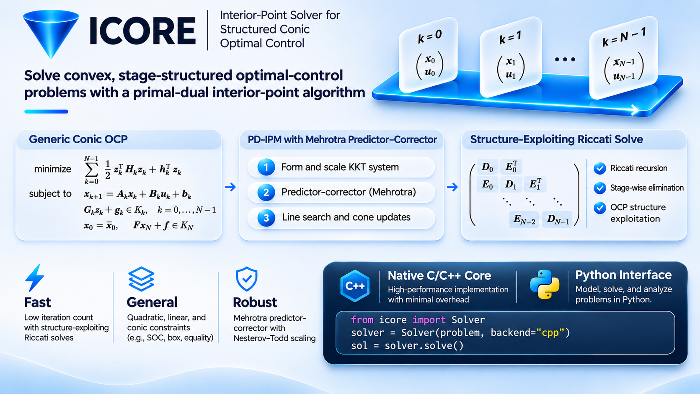

# ICORE

<p align="center">
  <a href="docs/assets/readme-hero.png">
    
  </a>
</p>

**A High-Performance Interior-Point Method for Conic OCPs via Riccati Equations**

Solve convex, stage-structured optimal-control problems with a primal-dual
interior-point algorithm. Native C and C++ backends use the same numerical source.
This checkout keeps the **0.20.0 numerical engine**, including the portable-build fix.
It reorganizes the examples and documentation; it is not a new optimization algorithm.

## Development transparency and review status

ICORE was developed in an iterative human–GPT workflow. Substantial portions of its implementation and documentation were generated and revised with GPT, under human direction.

Not all implementation details or documentation claims have undergone independent human review. The reported automated tests and benchmarks cover only the tested cases and environments; they do not establish correctness for all inputs or replace an independent code review.

Treat this release as research software. Review and validate it for your application before relying on it, particularly in safety-critical systems.

This note concerns ICORE-owned code and documentation, not third-party dependencies, which retain their original authorship and licenses.

## Start here

Use Python 3.10 or newer, a C/C++ compiler, `make`, and CMake. Linux and macOS are
supported by the build code; Windows users need WSL. On macOS, install the Command
Line Tools with `xcode-select --install` if a compiler is not already present.

From this repository's root directory:

```bash
python3 -m venv .venv
source .venv/bin/activate
python -m pip install -r requirements.txt
python -m tests.smoke
jupyter lab
```

Open one tutorial below, then **Run All**. Native libraries are compiled on first use
from the included source archives. No external solver source download is needed.
Keep the whole checkout together; this is a source distribution, not a PyPI wheel.
JAX is optional and is not required by the native tutorials or default comparison.

## Learn by changing a small problem

Each notebook defines its own model directly in its cells, calls `Solver`, and plots
the returned solution. No model-builder function hides the mathematics.

| Notebook | What you will learn |
|---|---|
| [01 · Scalar regulator](tutorials/01_scalar_regulator.ipynb) | Dynamics, quadratic cost, input bounds, and a first solve |
| [02 · Terminal tracking](tutorials/02_terminal_tracking.ipynb) | Position/velocity states, a target, and exact terminal equality |
| [03 · Input-rate limits](tutorials/03_input_rate_limits.ipynb) | A memory state, a cost cross term, and stage-local rate bounds |
| [04 · Soft corridor](tutorials/04_soft_corridor.ipynb) | Explicit decision slacks and penalties |
| [05 · Planar conic OCP](tutorials/05_planar_soc.ipynb) | Exact SOC norm limits and the `h - G[u,x]` sign convention |
| [06 · MPC updates](tutorials/06_mpc_updates.ipynb) | Reuse one workspace, update coefficients, and apply the first control |

The standard pattern is deliberately small:

```python
from icore import Solver

# Define problem = {A, B, b, x0, Q, R, S, q, r, G, h, F, f} as in a tutorial.
with Solver(problem, backend="cpp", tolerance=1e-8) as solver:
    solution = solver.solve()
    print(solution["x"])                 # N+1 states
    print(solution["u"])                 # N controls
    print(solver.factorization_plan)     # Requested/eligible policy
    print(solver.diagnostics)            # Actual native counters
```

Tutorials additionally call the optional `explain_solution` helper. It displays whether
structural presolve was requested **and actually applied**, the actual kernel, fallback
and refinement counters, original-model accuracy, and milliseconds. `DETAILED=True`
adds a separate untimed diagnostic replay with observed factorization/rejection events.
Neither reporting mode is required to use the solver.

## Compare with HPIPM and QOCO

Open **[Compare.ipynb](Compare.ipynb)**. It contains a single-problem mode and an All mode:

```python
RUN_ALL = True
ALL_N = 5
```

All mode runs all **393 stored coefficient instances** with ICORE C, ICORE C++,
HPIPM BALANCE, and QOCO. It uses arithmetic means in **ms**, and separates faster,
slower, tied, and incomparable cases. Change the displayed rival without solving again.
Failed, unsupported, and incomplete results remain visible and never count as speed wins.

There are 175 main cases, 72 additional models, 32 coefficient-update states, and
114 analytic KKT examples. This is not a claim of 393 independent application families.
The original 100 cases and the additional 293 cases remain in `problems/` and
`problems/extended/`, respectively. All 393 are available through one catalog.

## A small repository, with clear boundaries

```text
Compare.ipynb       Select problems and compare solvers.
tutorials/          Six independent, editable teaching notebooks.
problems/           The complete 393-instance coefficient catalog.
icore/              Public Python API and native solver source.
example_tools/      Optional loading, checking, plotting/reporting, and comparison helpers.
tests/              Numerical and example-layer regression checks.
docs/               API, build guide, benchmark scope, and the existing methods book.
```

Native numerical operations, solver tolerances, and recovery rules are unchanged.
Old release reports, experiments, machine-specific manifests, compiled libraries,
and caches are not included. Dependency archives have readable filenames.
Automatic content/version checks remain **internal**: they prevent stale libraries
or incompatible benchmark checkpoints from being reused. You do not configure or
copy any checksum strings. Build caches and `runs/` are ignored by Git.

## Tests and further reading

```bash
python -m unittest tests.test_examples tests.test_tutorials
python -m tests.smoke
python -m tests.portable_build       # Forces the portable GENERIC path.
```

- [API and array shapes](docs/API.md)
- [Build requirements and troubleshooting](docs/BUILDING.md)
- [Comparison timing and accuracy rules](docs/BENCHMARKING.md)
- [Source map](docs/CODE_GUIDE.md)
- [Validation of this repack](docs/VALIDATION.md)
- [Methods book](docs/ICORE-Methods.html) — includes the development-transparency note; download/open it in a browser.

Before publishing, review [the license note](LICENSE-NOTE.md). No new license for
ICORE-owned code is selected on the author's behalf. Third-party notices are
preserved; see [THIRD_PARTY_NOTICES.md](THIRD_PARTY_NOTICES.md).
