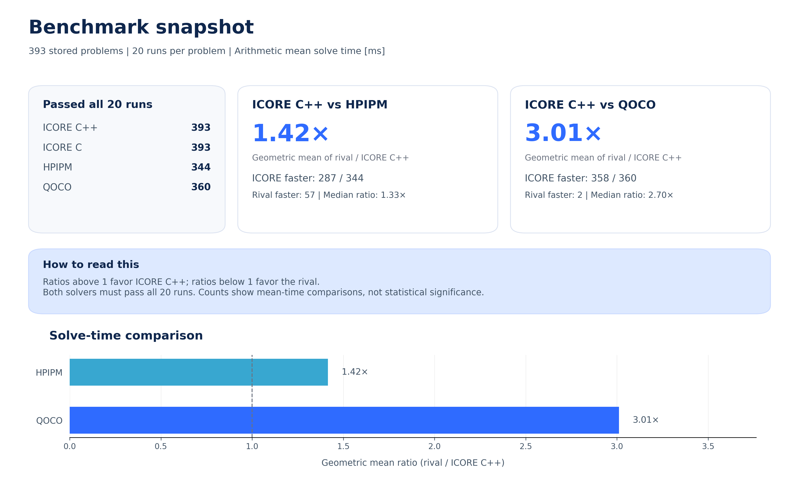

# ICORE

<p align="center">
  <a href="docs/assets/readme-hero.png">
    
  </a>
</p>

**A High-Performance Interior-Point Method for Conic OCPs via Riccati Equations**

Mehrotra predictor–corrector IPM with Riccati-based linear algebra and direct SOC
support. Native C/C++ core, Python interface.

## Quick start

Requires Python 3.10+, a C/C++ compiler, `make`, and CMake. [Build help](docs/BUILDING.md).

```bash
python3 -m venv .venv
source .venv/bin/activate
python -m pip install -r requirements.txt
python -m tests.smoke
jupyter lab
```

Open the [first tutorial](tutorials/01_scalar_regulator.ipynb) and **Run All**.
Native libraries compile on first use; JAX is optional.

## Examples

Each notebook defines the problem directly, solves it, and displays results,
presolve decisions, and diagnostics.

| Notebook | Model |
|---|---|
| [01 · Scalar regulator](tutorials/01_scalar_regulator.ipynb) | Dynamics, quadratic cost, input bounds |
| [02 · Terminal tracking](tutorials/02_terminal_tracking.ipynb) | Position/velocity tracking and terminal equality |
| [03 · Input-rate limits](tutorials/03_input_rate_limits.ipynb) | State augmentation and rate bounds |
| [04 · Soft corridor](tutorials/04_soft_corridor.ipynb) | Modeling slacks and penalties |
| [05 · Planar conic OCP](tutorials/05_planar_soc.ipynb) | Acceleration/speed norm limits with SOCs |
| [06 · MPC updates](tutorials/06_mpc_updates.ipynb) | Reuse a workspace and update the model |

```python
from icore import Solver

# Define the problem arrays as shown in the tutorials.
with Solver(problem, backend="cpp", tolerance=1e-8) as solver:
    solution = solver.solve()
    print(solution["x"], solution["u"])
    print(solver.diagnostics)
```

[API & array shapes](docs/API.md) · [Methods book](docs/ICORE-Methods.html) (open locally)

## Benchmarks

[Compare.ipynb](Compare.ipynb) runs one problem or the full catalog in `problems/`
with ICORE C/C++, HPIPM BALANCE, and QOCO. Set `ALL_N` for the repetition count.

<!-- BEGIN ICORE-BENCHMARK -->
**393 stored instances · 20 repetitions · audit tolerance `1e-08`**  
Recorded platform: `macOS-26.1-arm64-arm-64bit / arm64`; run: `all393_N20`.

[](docs/BENCHMARK_SUMMARY.md)

Arithmetic mean cold-solve times include returned outputs; setup, compilation,
model conversion, and audits are excluded. Ratios are geometric means of per-problem
ratios, using only pairs passing **every repetition**; values above 1 favor ICORE.
Pass counts are not support counts, and lower sample means are not significance claims.

[Full results & extra plots](docs/BENCHMARK_SUMMARY.md) ·
[Timing & reproduction](docs/BENCHMARKING.md)
<!-- END ICORE-BENCHMARK -->

## License & development

[MIT](LICENSE) for ICORE-owned code and documentation;
[third-party licenses](THIRD_PARTY_NOTICES.md) remain in effect.

Substantial implementation and documentation were generated and revised with GPT
under human direction. Not all details have undergone independent human review.
Research software, without warranty: validate it for your application, especially
in safety-critical systems. [Development notes](docs/DEVELOPMENT.md).
