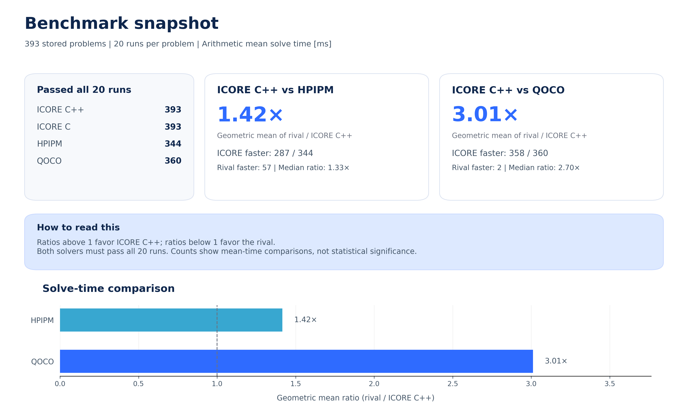
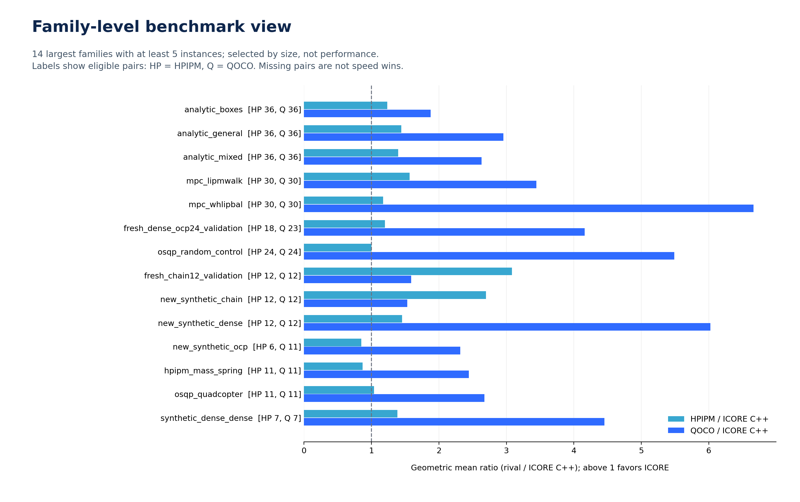
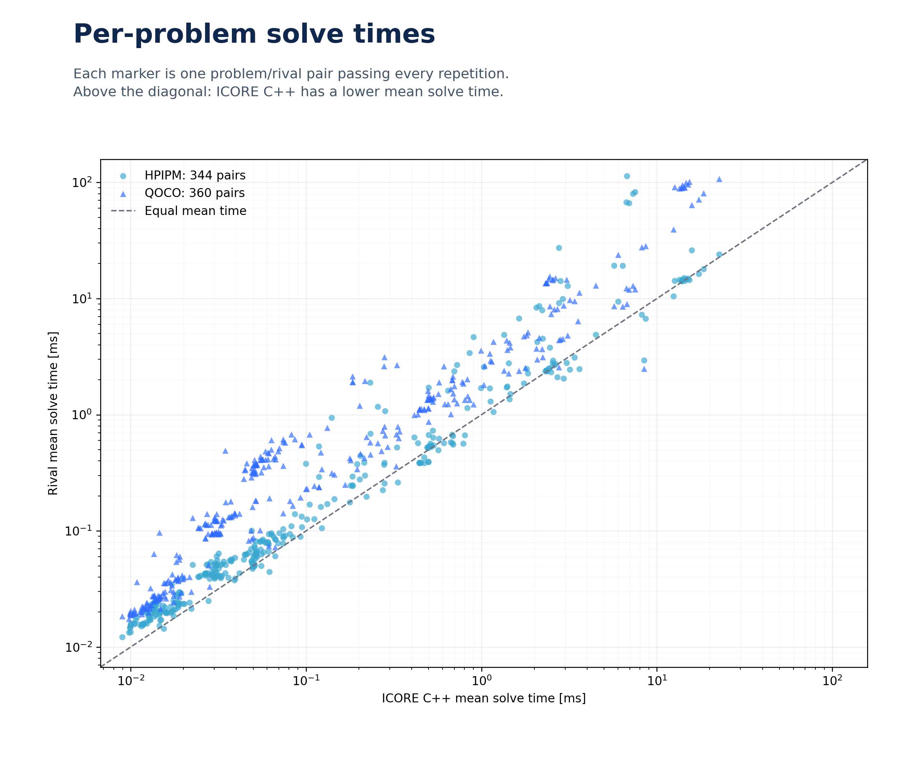

# Benchmark summary

Source: `all393_N20`; **393 coefficient instances**, **20 repetitions per method**, audit tolerance **1e-08**.

Recorded environment: **macOS-26.1-arm64-arm-64bit / arm64**.

All figures and tables below are recomputed from saved JSON, not from new solver runs.

## Outcome coverage

A passed problem requires every one of its 20 repetitions to pass. These are not counts of mathematically supported problem classes.

| Solver | Passed all | Failed/error | Unsupported | Unavailable | Incomplete | Invalid | Not requested |
|---|---:|---:|---:|---:|---:|---:|---:|
| ICORE C++ | 393 | 0 | 0 | 0 | 0 | 0 | 0 |
| ICORE C | 393 | 0 | 0 | 0 | 0 | 0 | 0 |
| HPIPM | 344 | 1 | 48 | 0 | 0 | 0 | 0 |
| QOCO | 360 | 33 | 0 | 0 | 0 | 0 | 0 |

Unsupported means an explicit adapter outcome. Failed means a recorded status/audit failure or an error, not lack of mathematical support.
Incomplete includes missing/duplicate repetition IDs. Invalid includes nonfinite, zero or negative timings in an otherwise passed group.

## Pairwise comparisons

| Rival | Both pass all repetitions | ICORE C++ lower mean | Rival lower mean | Geometric mean ratio (rival / ICORE C++) |
|---|---:|---:|---:|---:|
| HPIPM BALANCE | 344 | 287 | 57 | 1.416× |
| QOCO | 360 | 358 | 2 | 3.011× |

Times are arithmetic means over all N repetitions for each eligible problem/solver pair.
For each pair, r = mean(rival solve_ms) / mean(ICORE C++ solve_ms).
The aggregate is exp(mean(log(r))), with equal weight per problem. Above 1 favors ICORE; below 1 favors the rival.
The paired sets differ between rivals. Missing and failed cases do not become speed wins.
A lower mean is descriptive, not a confidence interval, a proof of superiority, or a measure of full application latency.

## Timing scope and reproducibility

The benchmark runner creates a fresh workspace and performs a cold solve for each repetition. `solve_ms` includes original-coordinate owned outputs, but excludes setup, compilation, shared model conversion, audits, and plotting.
The order is seeded and rotated/reversed by the runner; repetitions are not claimed to be independent randomly sampled workloads.
The catalog includes synthetic instances, coefficient updates, and equivalent formulations, not 393 independent application families.

### Recorded software/build information

| Solver | Recorded version | Recorded target | Recorded compiler |
|---|---|---|---|
| ICORE C | 0.20.0 | GENERIC | Apple clang version 15.0.0 (clang-1500.0.40.1) |
| ICORE C++ | 0.20.0 | GENERIC | Apple clang version 15.0.0 (clang-1500.0.40.1) |
| HPIPM | HPIPM | BLASFEO | see .build receipt |
| QOCO | 0.3.2 | sparse LDL | see .build receipt |

Python: `3.12.9`.
Hardware model, clock policy, and per-primitive backend choices are not fully recorded; they are not inferred here.
In particular, ICORE's recorded target is shown as supplied. This run is not a claim of best-possible tuning for every solver.

## Figures





The family plot selects at most 14 families with at least 5 instances, by decreasing family size and then name. HP/Q sample counts can be smaller than the family size. All families, including smaller ones, are retained in the family CSV.



## Files and regeneration

- [Overall ratios](benchmark-summary.csv)
- [Family ratios and eligible counts](benchmark-family-summary.csv)
- [Coverage categories](benchmark-coverage.csv)
- [Every problem/solver outcome](benchmark-outcomes.csv)

From the repository root:

```bash
python scripts/generate_benchmark_summary.py --runs-dir runs/all393_N20 --repo-root .
```

The source run files are not included in this documentation update. Keep your local `runs/` directory to reproduce the aggregation. No solver is executed by this command.
